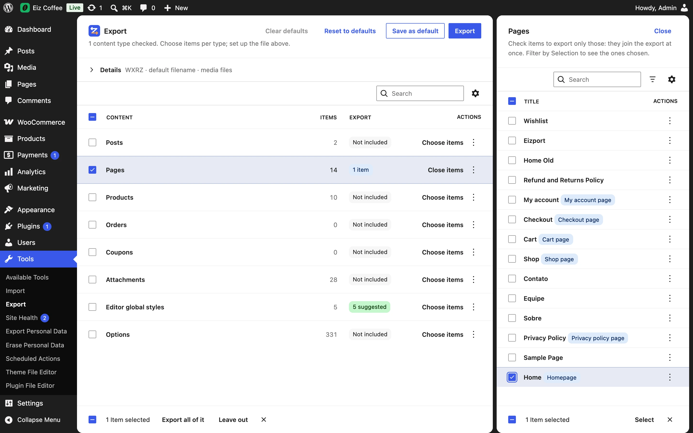

Each content type is exported whole (its row checked in the list) or **by items**, chosen in its side panel.

## Choosing

Check an item, or click it, and it joins the export at once: the list behind the panel shows **1 item**, **3 items**… Uncheck the last one and the type is left out again. The choice survives search and paging: check some on page 1, search, check more. **Close** goes back to the list. The Options panel works the same way.

## Suggestions

What you choose can suggest more, shown as **N suggested** in the other rows — counted, not named, and not exported until that row is checked:

| Choosing | Suggests |
| --- | --- |
| A page a setting points to (homepage, posts page, shop…) | Those settings, in **Options** ([linked settings](../options/#linked-settings)) |
| A page whose blocks show products (*Hand-picked Products*, *Product Collection* with hand-picked products, *Single Product*, *Featured Product*, `[products ids="…"]`) | Those products, in **Products** |
| Products with reviews | Their approved reviews, in **Product reviews** |
| Anything | The classic menus in the theme's locations and the navigations the items or the theme's templates use, in **Menus** ([menus](../menus/)) |
| A menu | The pages, posts and products it links to, in their rows |

Checking a row with suggestions brings them, and it still says *2 suggested* — with what else you chose: *2 suggested + Basics + 1 item*. Unchecking one of them in the row's panel turns the rest into plain items. **Export all of it** takes the whole type instead. Plugins add their own suggestions with [`eizport_suggested_items`](../../developers/hooks/#eizport_suggested_items).

## Finding items

- **Selection** — *All*, *Selected* or *Suggested*. A panel opens on *Selected* when its row has items chosen, else on *Suggested* when there are suggestions.
- **Status** and each **taxonomy** (product categories, tags…) narrow the list to find items; they don't export anything by themselves.

Exporting by filters (status, author, dates, terms) stays on the [classic screen](../classic-screen/) and in the [`eizport/export`](../../developers/abilities/) ability.

## What comes along

| With | Comes along |
| --- | --- |
| Any item | Its attached media and featured image (WordPress does this) |
| Any item | Media used in its content without being attached ([media](../media/)) |
| A product | Its variations. Its reviews only with the **Product reviews** row (they are suggested) — on the classic screen and in the ability without `reviews`, all of them |
| A page | Its child pages only if they are chosen too |
| An item with a role | The settings that point to it, suggested in the Options row ([linked settings](../options/#linked-settings)) |

## Roles

Items that a setting points to show a badge: **Homepage**, **Posts page**, **Privacy policy page**, **Site icon**, and the pages plugins register, like WooCommerce's **Shop page**, **Cart page**, **Checkout page**, **My account page** and **Terms and conditions page**. Plugins add their own through [`eizport_linked_options`](../../developers/hooks/#eizport_linked_options).

## Limits

The classic screen lists the latest 1,000 items per type (filter [`eizport_selection_limit`](../../developers/hooks/#eizport_selection_limit)); the new screen pages through all of them.
