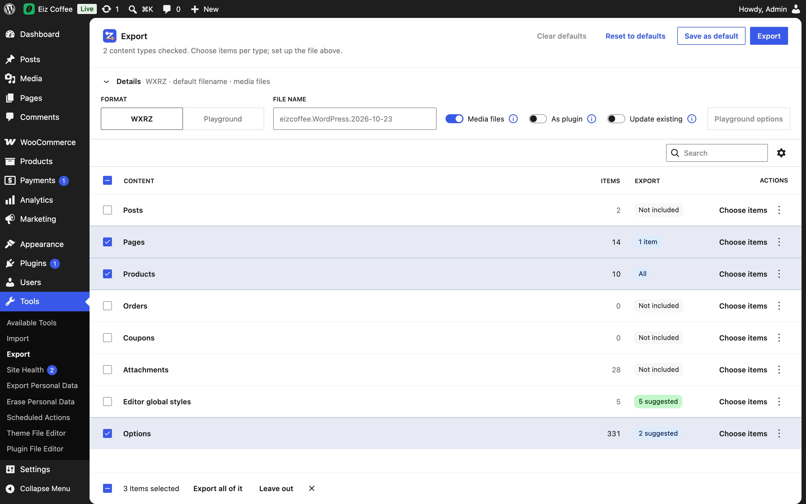

Tools → Export opens a screen built like WordPress's newest admin screens (DataViews and DataForm, on core's admin screen framework). It runs the plugin's [abilities](../../developers/abilities/), so the screen, REST and AI agents export the same way.

## The list

One row per thing that can be exported:

- **Content types** — Posts, Pages, Products, Orders, Coupons, Forms and any custom post type with an admin screen. Children travel with their parents (a product's variations).
- **Attachments** — media items, chosen directly.
- **Product reviews** — WooCommerce's approved reviews, right after Products ([choosing items](../choosing-items/#suggestions)). Products go without their reviews unless this row is checked.
- **Options** — site settings ([more](../options/)).

The **Export** column says what goes: *Not included*, *All*, *3 items*, or for Options *Basics + 2 items*; an unchecked Options row shows *2 suggested* (the homepage: `page_on_front` and `show_on_front`) when the items chosen have [linked settings](../options/#linked-settings). **Nothing checked exports all content**, as WordPress does.

Each row's actions: **Choose items** (opens the side panel; always shown, not only on hover; **Close items** on the row whose panel is open), **Export all of it** (where it doesn't export all yet; for Options, every option) and **Leave out** (rows included). Check several rows to act on them at once.

## The side panel

Clicking a row opens its items in a panel on the right ([choosing items](../choosing-items/)): what you check there joins the export at once, and **Close** goes back. The panel's URL is shareable: `…&p=/export?type=page`.

## The Details panel

Above the list, a **Details** line sums up the file — like *WXRZ · default filename · media files · as plugin* (*custom filename* once you type one). Click it to open its settings (it always starts closed):

| Field | What it does |
| --- | --- |
| **Format** | *WXR XML* (WordPress's plain file), *WXRZ* or *WXR ZIP* (a bundle, as soon as media files or settings go with it) or *Playground* ([formats](../file-and-formats/)) |
| **File name** | Empty: WordPress's usual `<site>.WordPress.<date>`, shown as the placeholder |
| **Media files** | Put the exported attachments' files inside the bundle; its ⓘ explains it |
| **As plugin** | Make the bundle a plugin that imports itself ([as plugin](../as-plugin/)); its ⓘ explains it. Off and disabled with Playground |
| **Update existing** | The import updates the pages, posts and products that already exist (same slug) instead of adding copies ([more](../../getting-started/importing/#updating-items-that-already-exist)); its ⓘ explains it. Off and disabled with Playground, which starts from a new site |
| **Playground options** | Where the Playground .zip opens and the themes and plugins it installs (enabled with the Playground format); a count on the button says how many are set ([Playground .zip](../../formats/playground-zip/#playground-options)) |

## Header actions

- **Reset to defaults** — goes back to the saved defaults (or to nothing chosen, without them). Dimmed when the choices already are those.
- **Clear defaults** — forgets the saved defaults; active only while **Reset to defaults** is dimmed.
- **Save as default** — keeps the current choices to start with next time ([saved defaults](../saved-defaults/)).
- **Export** — writes the file as a [copy](../../settings/copies/) and offers the download.

## On a phone

The list shows only the title column, with what is exported under it; the Details panel stacks; the side panel takes the screen.
