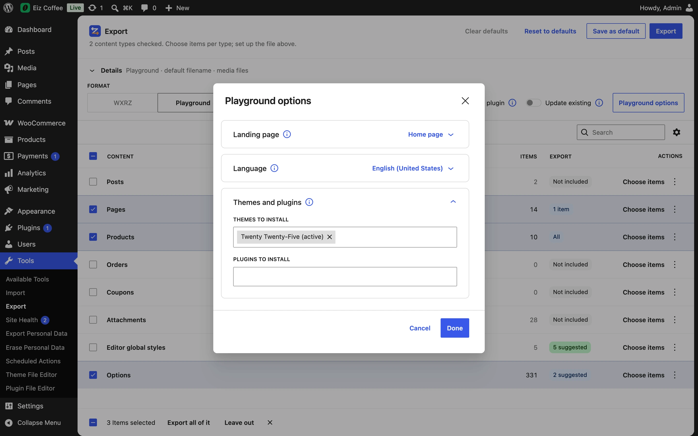

With the **Playground** format, the export is a `.zip` ready for [WordPress Playground](https://wordpress.org/playground/): a blueprint bundle that installs the themes and plugins you chose and imports the content.



## Run it

```bash
npx @wp-playground/cli@latest server --blueprint=./site.zip
```

Or open its link on playground.wordpress.net (new screen: the **Open in Playground** action in [Copies](../../settings/copies/); classic screen: *Keep a copy to open by link*). The copy is served with the CORS headers Playground needs.

**Even from a local server.** Playground runs in your browser, so a copy made on WordPress Studio or any `localhost` site opens on playground.wordpress.net without uploading it anywhere — the browser fetches it from your machine (the link works on your computer only).

## Playground options

**Details → Playground options** (enabled with the Playground format) opens three groups, one at a time; the button counts what's set.

### Landing page

Where Playground opens once the site is ready — **Home page** (the default), **Dashboard**, **A page** of this site, or **A path** (`/shop/`). A page goes in the blueprint as a relative path, `/?pagename=<its path>`, so it opens the same page whatever ID it gets in Playground. (Without it, Playground itself would open the dashboard.)

### Language

The language Playground opens in — **Site language** (the default), **Your language** (shown when your profile's is another one) or **English (United States)**. In another language than English, the blueprint runs Playground's `setSiteLanguage` step after the installs: it sets the site's language and fetches the translations of WordPress and of the themes and plugins from the WordPress.org directory. The translations this site has of the others — premium, custom — go inside the `.zip`. A language this site hasn't installed isn't offered.

### Themes and plugins

Any **installed** theme or plugin can go in. Plugins are installed **active or inactive as they are on this site**; of the themes, this site's is activated (when chosen), and a child theme brings its parent. The ones from the WordPress.org directory aren't copied: the blueprint installs them from the directory, **in the version this site has** (`woocommerce.11.2.1.zip`). The others — premium, custom, in-house — are zipped from the site into the bundle, and Playground installs them from there. WordPress's own update check says which ones are from the directory.

> **Use it responsibly.** Premium and custom themes and plugins are copied into the file. Share a Playground `.zip` only where their licenses allow — keep the ones with paid licenses to yourself or your team.

## Inside

```text
blueprint.json
<site>.WordPress.<date>.xml        the plain WXR (content inside, not in post_content/)
uploads/…                          media files, when Media files is on
post_content/…                     content files, when Content as .html files is on
themes/<stylesheet>.zip            each theme chosen that isn't in the directory (a child brings its parent)
plugins/<slug>.zip                 each plugin chosen that isn't in the directory
languages/plugins|themes/…         their translations, in a language other than English
```

## What the blueprint does

1. Installs the themes (parents first) — from the directory or from the bundle — and activates the active one, if chosen, else the first.
2. Installs and activates the plugins, the same way.
3. In another language: sets it (`setSiteLanguage`, which fetches the directory's translations) and writes the bundled ones.
4. Writes the media and content files and two temporary must-use plugins: one answers the importer's media downloads from the files and puts each `.html` back into its post (`wp_import_post_data_raw`); the other sets the options when the import ends, with IDs mapped.
5. Runs `importWxr` (Playground installs the WordPress Importer itself).
6. Removes the temporary plugins and files.

The [`eizport_playground_blueprint`](../../developers/hooks/#eizport_playground_blueprint) filter changes the blueprint before it is written.
