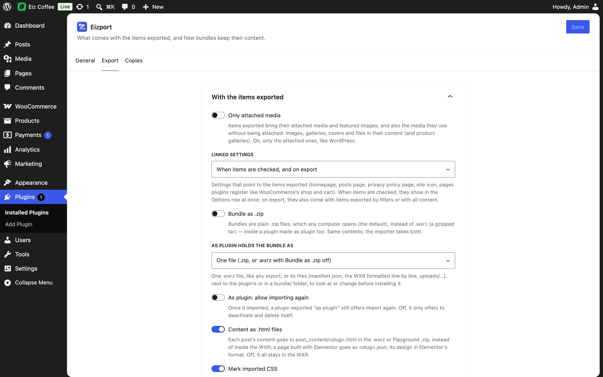

All in one card, **With the items exported**:

| Setting | Default | Per export (`eizport/export`) |
| --- | --- | --- |
| **Only attached media** — items bring only their attached media and featured images, as WordPress does, not the media used in their content ([media](../../exporting/media/)) | Off | `media_used` |
| **Linked settings** — when settings that point to the items exported come along: when items are checked and on export, when checked, on export, never ([options](../../exporting/options/#linked-settings)) | Both | `options.linked` |
| **Bundle as .zip** — bundles are plain `.zip` instead of `.wxrz` ([ZIP bundle](../../formats/zip-bundle/)) | Off | `zip` |
| **As plugin: allow importing again** — a plugin exported [as plugin](../../exporting/as-plugin/) still offers *Import again* once it imported | Off | — |
| **As plugin holds the bundle as** — in a plugin exported [as plugin](../../exporting/as-plugin/): one `.wxrz` file, or its files next to the plugin's, or in a `bundle/` folder | One .wxrz file | — |
| **Content as .html files** — each post's content in `post_content/<slug>.html` | On | `post_content` |
| **Mark imported CSS** — CSS rules from the [look's rows](../../exporting/appearance/) go between `/* head … */` and `/* tail … */` comments named after the file, to show where they came from; the importer can change it | On | `css_markers` |
